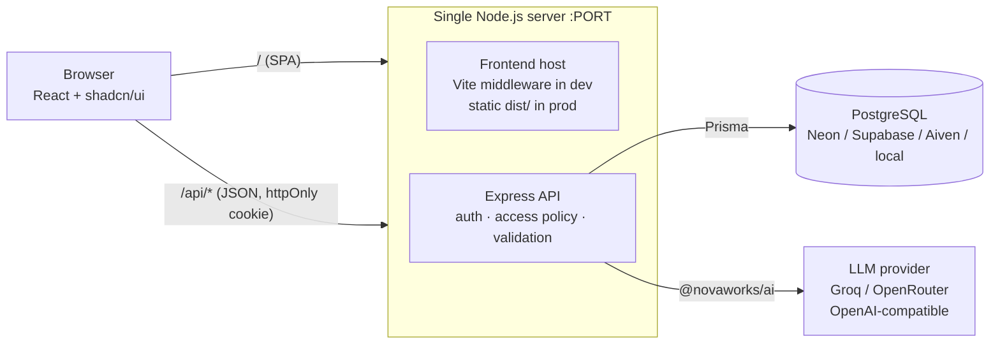
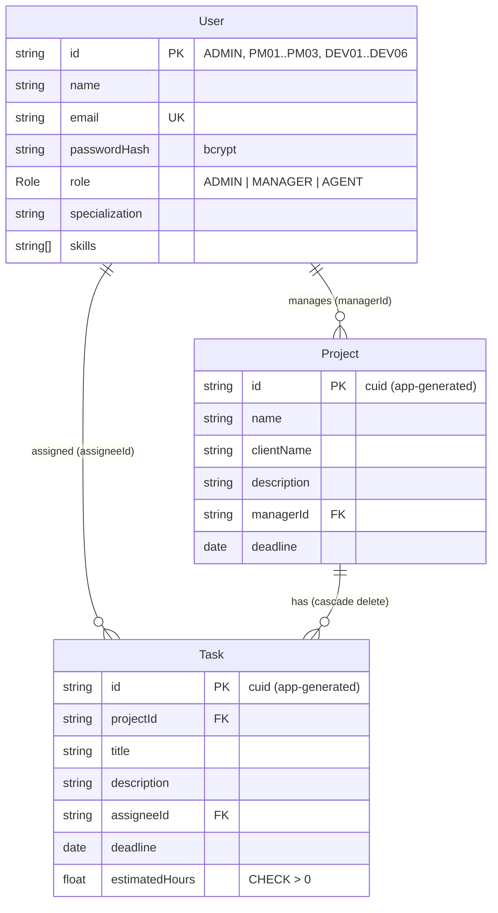
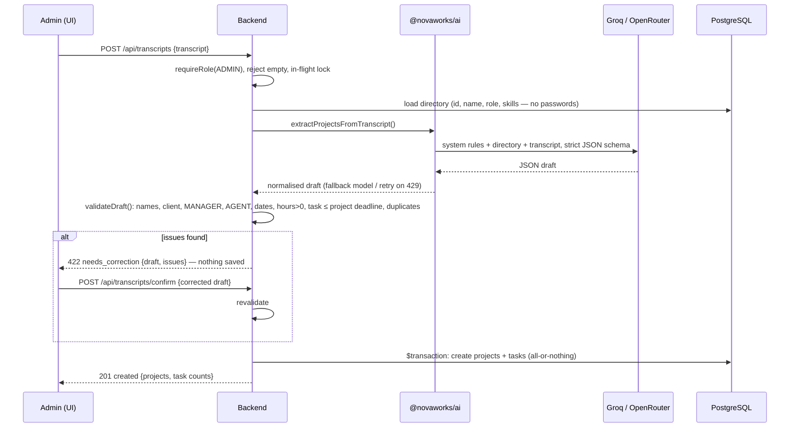

# Architecture — NovaWorks AI Project Manager

## 1. Overview

One Node.js process on **one port** serves both the REST API (`/api/*`) and the React frontend (`/*`).



## 2. Repository layout (npm workspaces)

| Folder | Package | Responsibility |
|---|---|---|
| `frontend/` | `@novaworks/frontend` | React 19 + Vite + Tailwind 4 + **shadcn/ui (preset `b1sAmVzcG`, Base UI)**. Pages, routing, API client. No business rules. |
| `backend/` | `@novaworks/backend` | Express API, session auth, **role-based access policy**, draft validation, all-or-nothing persistence (Prisma), serves the frontend. |
| `ai/` | `@novaworks/ai` | AI integration only: prompt, OpenAI-compatible client, model fallback + rate-limit retry, strict JSON-schema output, response normalisation. No DB access. |
| `backend/prisma/` | — | Schema, migrations, idempotent seed. |
| `supabase/` | — | Same schema as plain SQL migration + seed for Supabase (`supabase db push`), with RLS enabled. |
| `architecture/` | — | This documentation. |
| `docs/` | — | Official rulebook and challenge pack. |

### Backend modules

```
backend/src/
├── server.ts                 # single-port bootstrap (API + frontend)
├── app.ts                    # Express app, routers, error handler
├── config/env.ts             # typed environment config, provider defaults
├── db/prisma.ts              # Prisma client
├── lib/                      # http errors, dates, async handler
├── middleware/
│   ├── auth.ts               # JWT httpOnly cookie session, requireAuth, requireRole
│   └── error-handler.ts
└── modules/
    ├── auth/                 # POST /login, POST /logout, GET /me
    ├── users/                # GET /users (read-only directory)
    ├── projects/
    │   ├── access-policy.ts  # ★ single source of row-level access rules
    │   ├── project.serializer.ts
    │   └── projects.routes.ts
    ├── tasks/                # GET /tasks (scoped)
    └── transcripts/
        ├── draft-validator.ts    # ★ validates complete AI draft before save
        ├── transcript.service.ts # AI call → validate → transaction
        └── transcripts.routes.ts # admin-only
```

## 3. Data model



* User ids are the **same reference codes the AI sees** (`PM01`, `DEV03` …), so AI output maps directly to saved foreign keys.
* Project/Task ids are generated by the application, never by the AI.
* No cost, rate, or progress fields (out of scope).

## 4. Authentication & access control

* Login checks the bcrypt hash and sets a signed **httpOnly JWT cookie** (8 h).
* `requireAuth` loads the current user **from the session only** — a role or user id sent by the client is never trusted.
* `access-policy.ts` returns Prisma `where` filters used by **every** query:

| Role | Projects (`getProjects`) | Tasks (`getTasks`) | Transcript |
|---|---|---|---|
| ADMIN | all | all | ✅ |
| MANAGER | `managerId = me` | all tasks of my projects | ❌ 403 |
| AGENT | projects containing a task assigned to me | only `assigneeId = me` | ❌ 403 |

* `GET /api/projects/:id` outside the user's scope → **403**; unknown id → 404.
* An agent sees the related project's name and manager, never other agents' tasks.

## 5. Transcript → projects pipeline



### AI reliability measures
* **Strict JSON-schema structured output**, downgraded to JSON mode → plain text only if the provider rejects it.
* Model **fallback chain** (`AI_MODEL` → `AI_FALLBACK_MODELS`), automatic wait-and-retry on rate limits (≤ 30 s).
* `temperature: 0`; prompt rules: final decisions win, exclude rejected features, never invent people, transcript treated as data (prompt-injection guard).
* Names returned instead of ids are resolved **only** when unambiguous; unknown people are flagged, never created.
* Any AI failure or invalid output saves **nothing**.

## 6. Single-port serving

| Mode | Command | Frontend served by |
|---|---|---|
| Development | `npm run dev` | Vite in middleware mode inside Express (HMR) |
| Production | `npm run build && npm start` | Express static `frontend/dist` + SPA fallback |

## 7. Deployment

Any Node host that runs a long-lived process (Render, Railway, Fly.io, a VPS):

* Build: `npm ci && npm run build`
* Start: `npm run db:migrate && npm run db:seed && npm start`
* Env: `DATABASE_URL`, `AI_PROVIDER`, `AI_API_KEY`, `AI_MODEL`, `AI_FALLBACK_MODELS`, `SESSION_SECRET`, `NODE_ENV=production`

A ready `render.yaml` blueprint is included at the repository root.
